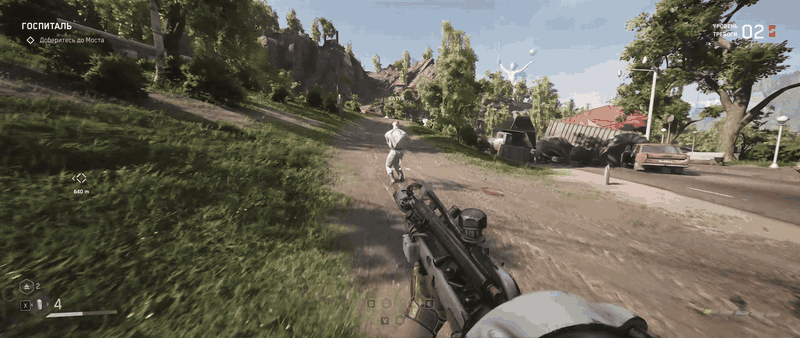
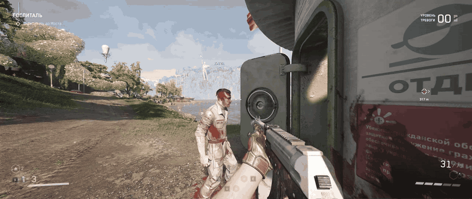
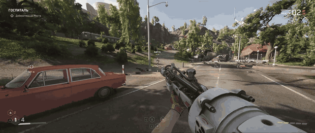
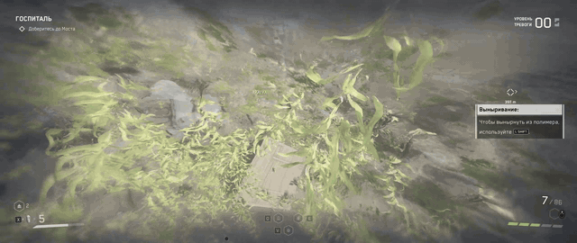
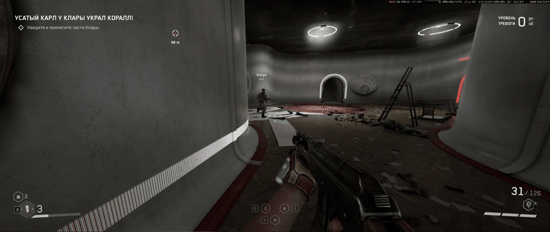

# Atomic Heart Ghost Co-op

[](https://boosty.to/tchasick/donate)











[Русский](#ru) | [English](#en)

<a id="ru"></a>

## Русский

Мод для двух игроков по локальной сети. Отображает напарника в мире Atomic Heart.
Текущая версия: **0.9.2-preview**.

### Возможности

- Модель напарника, имя и расстояние до него.
- Отображение движения, прыжков, приседания, оружия, прицеливания, атак и перезарядки.
- Меню по **Home**: видимость напарника и телепортация к нему.
  Телепортация экспериментальная и работает только на той же карте.

Это **визуальный co-op**. Враги, урон, задания, предметы и сохранения у каждого
игрока остаются отдельными. Оружие напарника отображается, но не наносит урон
в мире другого игрока.

### Требования

- Два компьютера с 64-битной Windows и установленной Atomic Heart.
- Одинаковые версии игры и мода у обоих игроков.
- Одна локальная сеть: общий роутер, Wi-Fi или подключение кабелем.
- Установочный архив мода с DLL, PAK и Python.
- Отдельно установленный [UE4SS for Atomic Heart](https://www.nexusmods.com/atomicheart/mods/186).

Для установки используется **полный архив выпуска** из раздела **Releases**, если
выпуск опубликован. **Code → Download ZIP** и архивы **Source code** содержат только
исходники, требующие самостоятельной сборки.

Архив `*-symbols.zip` содержит необязательные файлы отладки. Для установки мода
он не требуется.

В полном архиве Python уже есть. Отдельная установка Python и Unreal Engine
для игроков не требуется. **UE4SS скачивается и устанавливается отдельно.**

<details>
<summary>Поддерживаемая версия UE4SS</summary>

UE4SS `3.0.1 Beta #0 / cce0ed64`.
SHA-256 файла `UE4SS.dll`:

```text
A10A74378D90588FADE051AF00D0D4A76AAF87969DB262110031E2DEF05BA336
```

</details>

### Установка UE4SS

Установка выполняется на обоих компьютерах **до установки мода**.

1. Скачать сборку [UE4SS for Atomic Heart со страницы автора](https://www.nexusmods.com/atomicheart/mods/186?tab=files).
   Требуется сборка для Atomic Heart с указанными выше версией и SHA-256.
2. Открыть папку игры через Steam: **Свойства → Установленные файлы → Обзор**.
3. Распаковать содержимое архива UE4SS в `AtomicHeart\Binaries\Win64\`.
   В каталоге должны находиться `UE4SS.dll`, `dwmapi.dll`, `UE4SS-settings.ini`,
   `MemberVariableLayout.ini` и папка `UE4SS_Signatures`.

Дополнительные сведения: [инструкция автора сборки](https://www.nexusmods.com/atomicheart/mods/186).
Установщик Ghost Co-op проверяет установленный UE4SS и не скачивает его.

### Ручная установка мода

Установка выполняется на **обоих компьютерах** при закрытой игре.
Перед заменой файлов рекомендуется сохранить их резервные копии.

1. Распаковать полный архив мода в отдельную папку. Папка используется
   для запуска сервера и подключения и должна оставаться на диске.
2. Открыть папку установленной игры через Steam:
   **Свойства → Установленные файлы → Обзор**.
3. Скопировать файлы по таблице. Отсутствующие каталоги создать вручную.

| Файл или папка из архива | Расположение в папке игры |
| --- | --- |
| Папка `mod\AHGhostCoop\` целиком | `AtomicHeart\Binaries\Win64\Mods\`, чтобы внутри появилась папка `AHGhostCoop` |
| Файл `dist\AHGhostCoopNative.dll` | `AtomicHeart\Binaries\Win64\Mods\AHGhostCoopNative\dlls\main.dll` с переименованием в **`main.dll`** |
| Файл `dist\AHGhostCoopNavigation_P.pak` | `AtomicHeart\Content\Paks\~mods\` |

4. В `AtomicHeart\Binaries\Win64\Mods\mods.txt` добавить или обновить две строки,
   сохранив записи других модов:

   ```text
   AHGhostCoop : 1
   AHGhostCoopNative : 1
   ```

5. В `AtomicHeart\Binaries\Win64\Mods\AHGhostCoop\settings.ini` указать модель:

   ```ini
   [Visual]
   CharacterModel=procedural_p3
   ```

6. В существующих разделах `AtomicHeart\Binaries\Win64\UE4SS-settings.ini`
   установить следующие значения, сохранив остальные настройки:

   ```ini
   [Hooks]
   HookEngineTick=1
   HookGameViewportClientTick=1

   [General]
   EnableHotReloadSystem=0

   [Debug]
   ConsoleEnabled=0
   GuiConsoleEnabled=0
   ```

7. Старый `AtomicHeart\Content\Paks\LogicMods\AHGhostCoop.pak`, если он присутствует,
   перенести в резервную папку **за пределами каталога игры**.

Файлы `Host.cmd`, `Join.cmd`, `server\` и `runtime\python\` остаются в распакованной
папке мода. Копирование этих файлов в игру не требуется.

После отдельной установки UE4SS возможна автоматическая установка файлов мода
через `Install.cmd`. Пример для нестандартного пути игры, из PowerShell в папке мода:

```powershell
.\Install.cmd -GamePath "D:\SteamLibrary\steamapps\common\Atomic Heart"
```

### Запуск сервера

На компьютере первого игрока:

1. Запустить **`Host.cmd`** из распакованной папки мода.
2. Указать имя игрока и код комнаты длиной минимум четыре символа.
3. Передать второму игроку код комнаты и показанный IPv4-адрес адаптера домашней
   сети, например `192.168.1.10`.
4. Оставить окно открытым на время игры.

`Host.cmd` запускает сервер и подключает первого игрока.
Дополнительный запуск отдельного сервера не требуется.

Для нестандартного пути игры используется команда из PowerShell в папке мода:

```powershell
.\Host.cmd -GamePath "D:\SteamLibrary\steamapps\common\Atomic Heart"
```

### Подключение

На компьютере второго игрока:

1. Запустить **`Join.cmd`** из распакованной папки мода.
2. Указать имя игрока, код комнаты и IPv4-адрес первого компьютера.
3. Оставить окно открытым на время игры.

Пример для нестандартного пути игры:

```powershell
.\Join.cmd -GamePath "D:\SteamLibrary\steamapps\common\Atomic Heart"
```

После подключения оба игрока запускают Atomic Heart и загружают сохранения
**на одной карте**. Напарник появляется автоматически при нахождении поблизости.
**Home** открывает и закрывает меню мода. Закрытие окон Host и Join завершает
сетевую сессию.

### Проверка подключения

- Окна Host и Join должны оставаться открытыми; адрес сервера и код комнаты должны совпадать.
- Компьютеры должны находиться в одной локальной сети, персонажи должны быть на одной карте.
- При нестандартном пути игры используется параметр `-GamePath` для Host и Join.
- При блокировке брандмауэром на компьютере первого игрока выполняется команда
  из PowerShell **от имени администратора** в папке мода:

  ```powershell
  .\tools\firewall.ps1
  ```

Правило разрешает UDP-порт `47777` для локальной сети с профилем Windows
**«Частная»**. Состояние мода и соединения отображается через `Diagnostics.cmd`.
Для другого пути игры: `Diagnostics.cmd -GamePath "путь к игре"`.

### Лицензия

Код мода распространяется по [MIT](LICENSE).
Лицензии сторонних компонентов: [THIRD_PARTY_NOTICES.md](THIRD_PARTY_NOTICES.md).

<a id="en"></a>

## English

A two-player LAN mod that displays the other player in the Atomic Heart world.
Current version: **0.9.2-preview**.

### Features

- A character model for the other player, with a name and distance indicator.
- Visual movement, jumping, crouching, weapons, aiming, attacks and reloading.
- A **Home** menu with player visibility and teleport controls.
  Teleportation is experimental and only works within the same map.

This is **visual co-op**. Enemies, damage, quests, items and saves remain separate
for each player. Remote weapons are visible but do not deal damage in the other
player's world.

### Requirements

- Two computers running 64-bit Windows with Atomic Heart installed.
- Matching game and mod versions on both computers.
- A shared local network, using the same router over Wi-Fi or Ethernet.
- A mod installation archive containing the DLL, PAK and Python.
- A separately installed [UE4SS for Atomic Heart](https://www.nexusmods.com/atomicheart/mods/186).

Installation requires the **complete release archive** from **Releases**, when a
release is available. **Code → Download ZIP** and **Source code** archives contain
source files that require a separate build.

Python is included in the complete archive. Players do not need a separate
Python or Unreal Engine installation. **UE4SS must be downloaded and installed separately.**

The `*-symbols.zip` archive contains optional debugging files and is not required
to install the mod.

<details>
<summary>Supported UE4SS version</summary>

UE4SS `3.0.1 Beta #0 / cce0ed64`.
SHA-256 of `UE4SS.dll`:

```text
A10A74378D90588FADE051AF00D0D4A76AAF87969DB262110031E2DEF05BA336
```

</details>

### UE4SS installation

UE4SS installation is required on both computers **before mod installation**.

1. The required package is available on the author's
   [UE4SS for Atomic Heart download page](https://www.nexusmods.com/atomicheart/mods/186?tab=files).
   The build must match the version and SHA-256 listed above.
2. The game directory is accessible through Steam:
   **Properties → Installed Files → Browse**.
3. The UE4SS archive contents are extracted into `AtomicHeart\Binaries\Win64\`.
   This directory must contain `UE4SS.dll`, `dwmapi.dll`, `UE4SS-settings.ini`,
   `MemberVariableLayout.ini` and the `UE4SS_Signatures` folder.

Additional information: [the package author's installation instructions](https://www.nexusmods.com/atomicheart/mods/186).
The Ghost Co-op installer checks the existing UE4SS installation and does not download it.

### Manual mod installation

The following procedure applies to **both computers**, with the game closed.
Backups of files being replaced are recommended.

1. The complete mod archive is extracted into a separate folder. This folder
   is used for hosting and joining and must remain on disk.
2. The game directory is accessible through Steam:
   **Properties → Installed Files → Browse**.
3. The files are copied according to the table below. Missing directories must be created.

| File or folder from the archive | Destination within the game directory |
| --- | --- |
| The entire `mod\AHGhostCoop\` folder | `AtomicHeart\Binaries\Win64\Mods\`, resulting in an `AHGhostCoop` subfolder |
| `dist\AHGhostCoopNative.dll` | `AtomicHeart\Binaries\Win64\Mods\AHGhostCoopNative\dlls\main.dll`, renamed to **`main.dll`** |
| `dist\AHGhostCoopNavigation_P.pak` | `AtomicHeart\Content\Paks\~mods\` |

4. The following entries are added or updated in `AtomicHeart\Binaries\Win64\Mods\mods.txt`.
   Entries for other mods are preserved:

   ```text
   AHGhostCoop : 1
   AHGhostCoopNative : 1
   ```

5. The character model is configured in `AtomicHeart\Binaries\Win64\Mods\AHGhostCoop\settings.ini`:

   ```ini
   [Visual]
   CharacterModel=procedural_p3
   ```

6. The following values are set in the existing sections of
   `AtomicHeart\Binaries\Win64\UE4SS-settings.ini`. Other settings are preserved:

   ```ini
   [Hooks]
   HookEngineTick=1
   HookGameViewportClientTick=1

   [General]
   EnableHotReloadSystem=0

   [Debug]
   ConsoleEnabled=0
   GuiConsoleEnabled=0
   ```

7. An old `AtomicHeart\Content\Paks\LogicMods\AHGhostCoop.pak`, if present,
   is moved to a backup folder **outside the game directory**.

`Host.cmd`, `Join.cmd`, `server\` and `runtime\python\` remain in the extracted
mod folder. These files do not need to be copied into the game directory.

After the separate UE4SS installation, `Install.cmd` can install the mod files
automatically. Example for a custom game location, from PowerShell in the mod folder:

```powershell
.\Install.cmd -GamePath "D:\SteamLibrary\steamapps\common\Atomic Heart"
```

### Hosting

On the first player's computer:

1. **`Host.cmd`** is launched from the extracted mod folder.
2. A player name and a room code of at least four characters are entered.
3. The room code and the displayed home network adapter IPv4 address,
   such as `192.168.1.10`, are shared with the second player.
4. The window remains open throughout the session.

`Host.cmd` starts the server and connects the first player.
A separate server process does not need to be started manually.

For a custom game location, the following command runs from PowerShell in the mod folder:

```powershell
.\Host.cmd -GamePath "D:\SteamLibrary\steamapps\common\Atomic Heart"
```

### Joining

On the second player's computer:

1. **`Join.cmd`** is launched from the extracted mod folder.
2. A player name, the shared room code and the first computer's IPv4 address are entered.
3. The window remains open throughout the session.

Example for a custom game location:

```powershell
.\Join.cmd -GamePath "D:\SteamLibrary\steamapps\common\Atomic Heart"
```

Once connected, both players launch Atomic Heart and load saves **on the same map**.
The other player appears automatically when nearby. **Home** opens and closes the
mod menu. Closing the Host and Join windows ends the network session.

### Connection checks

- Both Host and Join windows must remain open; the server address and room code must match.
- Both computers must share a local network, and both characters must be on the same map.
- Custom game locations require the `-GamePath` parameter for Host and Join.
- If Windows Firewall blocks the connection, the following command runs from
  PowerShell **as administrator** in the mod folder on the hosting computer:

  ```powershell
  .\tools\firewall.ps1
  ```

The rule allows UDP port `47777` from the local network on the Windows **Private**
network profile. `Diagnostics.cmd` displays mod and connection status.
For a custom game location: `Diagnostics.cmd -GamePath "path to the game"`.

### License

The mod's code is available under [MIT](LICENSE).
Third-party licenses: [THIRD_PARTY_NOTICES.md](THIRD_PARTY_NOTICES.md).
