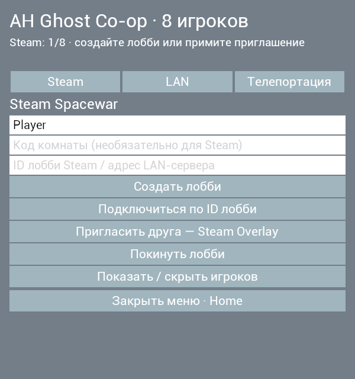
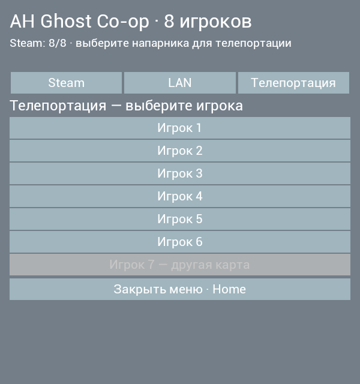

# Atomic Heart Ghost Co-op

[](https://boosty.to/tchasick/donate)


[Русский](#ru) | [English](#en)

<a id="ru"></a>

## Русский

Визуальный кооп для **до 8 игроков, включая хоста**, по локальной сети или через Steam.

### Возможности

- Модель напарника, имя и расстояние до него.
- Отображение движения, прыжков, приседания, оружия, прицеливания, атак и перезарядки.
- Меню по **Home**: создание и вход в Steam/LAN-лобби, приглашения через Steam Overlay.
- Телепортация к напарникам

Это **визуальный co-op**. Враги, урон, задания, предметы и сохранения у каждого
игрока остаются отдельными. Оружие напарника отображается, но не наносит урон
в мире другого игрока.

### Требования

- До восьми компьютеров с 64-битной Windows и установленной Atomic Heart.
- Одинаковые версии игры и мода у всех игроков.
- Для LAN - одна локальная сеть; для Steam - интернет и отдельный Steam-аккаунт у каждого.
- Установочный архив мода с DLL, PAK и Python.
- Отдельно установленный [UE4SS for Atomic Heart](https://www.nexusmods.com/atomicheart/mods/186).

Для установки используется **полный архив выпуска** из раздела **Releases**, если
выпуск опубликован. **Code → Download ZIP** и архивы **Source code** содержат только
исходники, требующие самостоятельной сборки.

> Архив `*-symbols.zip` содержит необязательные файлы отладки. Для установки мода
он не требуется.

В полном архиве Python уже есть. Отдельная установка Python и Unreal Engine
для игроков не требуется. **UE4SS скачивается и устанавливается отдельно.**

<details>
<summary>Поддерживаемая версия UE4SS</summary>

UE4SS `3.0.1 Beta #0 / cce0ed64`.
SHA-256 файла `UE4SS.dll`:

```text
A10A74378D90588FADE051AF00D0D4A76AAF87969DB262110031E2DEF05BA336
```

</details>

### Установка UE4SS

Установка выполняется на всех компьютерах **до установки мода**.

1. Скачать сборку [UE4SS for Atomic Heart со страницы автора](https://www.nexusmods.com/atomicheart/mods/186?tab=files).
   Требуется сборка для Atomic Heart с указанными выше версией и SHA-256.
2. Открыть папку игры через Steam: **Свойства → Установленные файлы → Обзор**.
3. Распаковать содержимое архива UE4SS в `AtomicHeart\Binaries\Win64\`.
   В каталоге должны находиться `UE4SS.dll`, `dwmapi.dll`, `UE4SS-settings.ini`,
   `MemberVariableLayout.ini` и папка `UE4SS_Signatures`.

Дополнительные сведения: [инструкция автора сборки](https://www.nexusmods.com/atomicheart/mods/186).
Установщик Ghost Co-op проверяет установленный UE4SS и не скачивает его.

### Ручная установка мода

Установка выполняется на **всех компьютерах** при закрытой игре.
Перед заменой файлов рекомендуется сохранить их резервные копии.

1. Распаковать полный архив мода в отдельную папку. Папка используется
   для установки.
2. Открыть папку установленной игры через Steam:
   **Свойства → Установленные файлы → Обзор**.
3. Скопировать файлы по таблице. Отсутствующие каталоги создать вручную.

| Файл или папка из архива | Расположение в папке игры |
| --- | --- |
| Папка `mod\AHGhostCoop\` целиком | `AtomicHeart\Binaries\Win64\Mods\`, чтобы внутри появилась папка `AHGhostCoop` |
| Файл `dist\AHGhostCoopNative.dll` | `AtomicHeart\Binaries\Win64\Mods\AHGhostCoopNative\dlls\main.dll` с переименованием в **`main.dll`** |
| Файл `dist\AHGhostCoopNavigation_P.pak` | `AtomicHeart\Content\Paks\~mods\` |
| Папка `server\` целиком | `AtomicHeart\Binaries\Win64\Mods\AHGhostCoop\bridge\server\` |
| Папка `runtime\` целиком, включая `python\` и `steam\` | `AtomicHeart\Binaries\Win64\Mods\AHGhostCoop\bridge\runtime\` |

4. В `AtomicHeart\Binaries\Win64\Mods\mods.txt` добавить или обновить две строки,
   сохранив записи других модов:

   ```text
   AHGhostCoop : 1
   AHGhostCoopNative : 1
   ```

5. В `AtomicHeart\Binaries\Win64\Mods\AHGhostCoop\settings.ini` указать модель:

   ```ini
   [Visual]
   CharacterModel=procedural_p3
   ```

6. В существующих разделах `AtomicHeart\Binaries\Win64\UE4SS-settings.ini`
   установить следующие значения, сохранив остальные настройки:

   ```ini
   [Hooks]
   HookEngineTick=1
   HookGameViewportClientTick=1

   [General]
   EnableHotReloadSystem=0

   [Debug]
   ConsoleEnabled=0
   GuiConsoleEnabled=0
   ```

7. Старый `AtomicHeart\Content\Paks\LogicMods\AHGhostCoop.pak`, если он присутствует,
   перенести в резервную папку **за пределами каталога игры**.

Создать пустую папку `AtomicHeart\Binaries\Win64\Mods\AHGhostCoop\state\`.
Папки `bridge\server\`, `bridge\runtime\python\` и `bridge\runtime\steam\`
обязательны для лобби в меню: одной DLL и Lua-скрипта недостаточно.
`Host.cmd` и `Join.cmd` остаются в распакованной папке для дополнительного ручного запуска.

После отдельной установки UE4SS возможна автоматическая установка файлов мода
через `Install.cmd`. Пример для нестандартного пути игры, из PowerShell в папке мода:

```powershell
.\Install.cmd -GamePath "D:\SteamLibrary\steamapps\common\Atomic Heart"
```

### Лобби в игровом меню



После установки полного архива запустите игру и загрузите сохранение. Нажмите **Home**:

- **Steam → Создать лобби** создаёт комнату на 8 участников. Код комнаты необязателен.
- **Пригласить друга - Steam Overlay** открывает стандартный диалог приглашений Steam.
  Выберите друга и отправьте приглашение. Друг принимает его в Steam, мод обрабатывает вход.
- Для входа по номеру комнаты: введите ID в третье поле и нажмите **Подключиться по ID лобби**.
- **LAN** позволяет создать сервер или подключиться по IP. Для LAN нужен одинаковый код комнаты.
- **Телепортация** показывает до семи напарников. Нажмите имя нужного игрока;
  игроки на другой карте и без свежих координат недоступны для телепортации.
- **Покинуть лобби / Отключиться** завершает ваше подключение.

Сетевой компонент запускается модом в фоне и завершается вместе с игрой.
Отдельно запускать Host/Join не требуется. Steam Overlay должен быть включён для игры,
а настоящий Steam Overlay должен быть подключён к процессу игры.



<details>
<summary>Дополнительный запуск через Host / Join / SteamHost / SteamJoin</summary>

### Запуск сервера

На компьютере первого игрока:

1. Запустить **`Host.cmd`** из распакованной папки мода.
2. Указать имя игрока и код комнаты длиной минимум четыре символа.
3. Передать остальным игрокам код комнаты и показанный IPv4-адрес адаптера домашней
   сети, например `192.168.1.10`.
4. Оставить окно открытым на время игры.

`Host.cmd` запускает сервер и подключает первого игрока.
Дополнительный запуск отдельного сервера не требуется.

Для нестандартного пути игры используется команда из PowerShell в папке мода:

```powershell
.\Host.cmd -GamePath "D:\SteamLibrary\steamapps\common\Atomic Heart"
```

### Подключение (ручное)

На компьютере каждого из остальных игроков (до семи):

1. Запустить **`Join.cmd`** из распакованной папки мода.
2. Указать имя игрока, код комнаты и IPv4-адрес первого компьютера.
3. Оставить окно открытым на время игры.

Пример для нестандартного пути игры:

```powershell
.\Join.cmd -GamePath "D:\SteamLibrary\steamapps\common\Atomic Heart"
```

После подключения все игроки запускают Atomic Heart и загружают сохранения
**на одной карте**. Напарники появляются автоматически при нахождении поблизости.
**Home** открывает и закрывает меню мода. Закрытие окон Host и Join завершает
сетевую сессию.

### Подключение через Steam Spacewar (ручное)

1. Запустить Steam и войти в свой аккаунт на каждом компьютере. 
2. Хост запускает **`SteamHost.cmd`**, вводит имя и код комнаты и передаёт друзьям
   показанный **lobby ID** и код комнаты.
3. До семи остальных игроков запускают **`SteamJoin.cmd`** и вводят эти данные.
4. Оставить окна открытыми, загрузить одну карту. Проброс портов для Steam не требуется.

```powershell
.\SteamHost.cmd -Name Host -Room "my-room" -GamePath "D:\Games\Atomic Heart"
.\SteamJoin.cmd -Name Friend -Room "my-room" -Lobby 109775240000000000 -GamePath "D:\Games\Atomic Heart"
```

</details>


### Лицензия

Код мода распространяется по [MIT](LICENSE).
Лицензии сторонних компонентов: [THIRD_PARTY_NOTICES.md](THIRD_PARTY_NOTICES.md).

<a id="en"></a>

## English

Visual co-op for **up to 8 players including the host**, over LAN or Steam.

### Features

- A character model for the other player, with a name and distance indicator.
- Visual movement, jumping, crouching, weapons, aiming, attacks and reloading.
- A **Home** menu for creating and joining Steam/LAN lobbies, with invitations through Steam Overlay.
- Teleportation to other players.

This is **visual co-op**. Enemies, damage, quests, items and saves remain separate
for each player. Remote weapons are visible but do not deal damage in the other
player's world.

### Requirements

- Up to eight computers running 64-bit Windows with Atomic Heart installed.
- Matching game and mod versions on all computers.
- A shared local network for LAN, or internet and separate Steam accounts for Steam.
- A mod installation archive containing the DLL, PAK and Python.
- A separately installed [UE4SS for Atomic Heart](https://www.nexusmods.com/atomicheart/mods/186).

Installation requires the **complete release archive** from **Releases**, when a
release is available. **Code → Download ZIP** and **Source code** archives contain
source files that require a separate build.

> The `*-symbols.zip` archive contains optional debugging files. It is not required
> to install the mod.

Python is included in the complete archive. Players do not need a separate
Python or Unreal Engine installation. **UE4SS must be downloaded and installed separately.**

<details>
<summary>Supported UE4SS version</summary>

UE4SS `3.0.1 Beta #0 / cce0ed64`.
SHA-256 of `UE4SS.dll`:

```text
A10A74378D90588FADE051AF00D0D4A76AAF87969DB262110031E2DEF05BA336
```

</details>

### UE4SS installation

UE4SS installation is required on all computers **before mod installation**.

1. The required package is available on the author's
   [UE4SS for Atomic Heart download page](https://www.nexusmods.com/atomicheart/mods/186?tab=files).
   The build must match the version and SHA-256 listed above.
2. The game directory is accessible through Steam:
   **Properties → Installed Files → Browse**.
3. The UE4SS archive contents are extracted into `AtomicHeart\Binaries\Win64\`.
   This directory must contain `UE4SS.dll`, `dwmapi.dll`, `UE4SS-settings.ini`,
   `MemberVariableLayout.ini` and the `UE4SS_Signatures` folder.

Additional information: [the package author's installation instructions](https://www.nexusmods.com/atomicheart/mods/186).
The Ghost Co-op installer checks the existing UE4SS installation and does not download it.

### Manual mod installation

The following procedure applies to **all computers**, with the game closed.
Backups of files being replaced are recommended.

1. The complete mod archive is extracted into a separate folder. This folder
   is used for installation. 
2. The game directory is accessible through Steam:
   **Properties → Installed Files → Browse**.
3. The files are copied according to the table below. Missing directories must be created.

| File or folder from the archive | Destination within the game directory |
| --- | --- |
| The entire `mod\AHGhostCoop\` folder | `AtomicHeart\Binaries\Win64\Mods\`, resulting in an `AHGhostCoop` subfolder |
| `dist\AHGhostCoopNative.dll` | `AtomicHeart\Binaries\Win64\Mods\AHGhostCoopNative\dlls\main.dll`, renamed to **`main.dll`** |
| `dist\AHGhostCoopNavigation_P.pak` | `AtomicHeart\Content\Paks\~mods\` |
| The entire `server\` folder | `AtomicHeart\Binaries\Win64\Mods\AHGhostCoop\bridge\server\` |
| The entire `runtime\` folder, including `python\` and `steam\` | `AtomicHeart\Binaries\Win64\Mods\AHGhostCoop\bridge\runtime\` |

4. The following entries are added or updated in `AtomicHeart\Binaries\Win64\Mods\mods.txt`.
   Entries for other mods are preserved:

   ```text
   AHGhostCoop : 1
   AHGhostCoopNative : 1
   ```

5. The character model is configured in `AtomicHeart\Binaries\Win64\Mods\AHGhostCoop\settings.ini`:

   ```ini
   [Visual]
   CharacterModel=procedural_p3
   ```

6. The following values are set in the existing sections of
   `AtomicHeart\Binaries\Win64\UE4SS-settings.ini`. Other settings are preserved:

   ```ini
   [Hooks]
   HookEngineTick=1
   HookGameViewportClientTick=1

   [General]
   EnableHotReloadSystem=0

   [Debug]
   ConsoleEnabled=0
   GuiConsoleEnabled=0
   ```

7. An old `AtomicHeart\Content\Paks\LogicMods\AHGhostCoop.pak`, if present,
   is moved to a backup folder **outside the game directory**.

Create the empty `AtomicHeart\Binaries\Win64\Mods\AHGhostCoop\state\` directory.
The installed `bridge\server\`, `bridge\runtime\python\` and `bridge\runtime\steam\`
folders are required for in-game lobbies. The DLL and Lua script alone are insufficient.
`Host.cmd` and `Join.cmd` remain in the extracted folder as optional launchers.

After the separate UE4SS installation, `Install.cmd` can install the mod files
automatically. Example for a custom game location, from PowerShell in the mod folder:

```powershell
.\Install.cmd -GamePath "D:\SteamLibrary\steamapps\common\Atomic Heart"
```

### In-game lobby menu


Install the complete archive, launch the game, load a save and press **Home**:

- **Steam → Create lobby** creates a room for 8 players. The room code is optional.
- **Invite friend - Steam Overlay** opens Steam's standard invite dialog.
  Select a friend and send an invitation. They accept it in Steam, and the mod handles joining.
- To join by lobby ID, enter the ID in the third field and select **Join by lobby ID**.
- **LAN** lets you host a server or connect by IP. Use the same room code for LAN.
- **Teleport** lists up to seven other players. Select the player you want to teleport to;
  players on other maps or without recent position updates are unavailable.
- **Leave lobby / Disconnect** ends your connection.

The networking component starts in the background and exits with the game.
You do not need to run Host/Join separately. Steam Overlay must be enabled for the game
and attached to the game process.


<details>
<summary>Optional launchers: Host / Join / SteamHost / SteamJoin</summary>

### Hosting

On the first player's computer:

1. **`Host.cmd`** is launched from the extracted mod folder.
2. A player name and a room code of at least four characters are entered.
3. The room code and the displayed home network adapter IPv4 address,
   such as `192.168.1.10`, are shared with the other players.
4. The window remains open throughout the session.

`Host.cmd` starts the server and connects the first player.
A separate server process does not need to be started manually.

For a custom game location, the following command runs from PowerShell in the mod folder:

```powershell
.\Host.cmd -GamePath "D:\SteamLibrary\steamapps\common\Atomic Heart"
```

### Joining (manual)

On each of the other players' computers (up to seven):

1. **`Join.cmd`** is launched from the extracted mod folder.
2. A player name, the shared room code and the first computer's IPv4 address are entered.
3. The window remains open throughout the session.

Example for a custom game location:

```powershell
.\Join.cmd -GamePath "D:\SteamLibrary\steamapps\common\Atomic Heart"
```

Once connected, all players launch Atomic Heart and load saves **on the same map**.
Other players appear automatically when nearby. **Home** opens and closes the
mod menu. Closing the Host and Join windows ends the network session.

### Connecting through Steam Spacewar (manual)

1. Start Steam and sign in to your account on each computer.
2. The host runs **`SteamHost.cmd`**, enters a player name and room code, and shares
   the displayed **lobby ID** and room code with friends.
3. Up to seven other players run **`SteamJoin.cmd`** and enter those details.
4. Keep the windows open and load the same map. Steam does not require port forwarding.

```powershell
.\SteamHost.cmd -Name Host -Room "my-room" -GamePath "D:\Games\Atomic Heart"
.\SteamJoin.cmd -Name Friend -Room "my-room" -Lobby 109775240000000000 -GamePath "D:\Games\Atomic Heart"
```

</details>

### License

The mod's code is available under [MIT](LICENSE).
Third-party licenses: [THIRD_PARTY_NOTICES.md](THIRD_PARTY_NOTICES.md).
